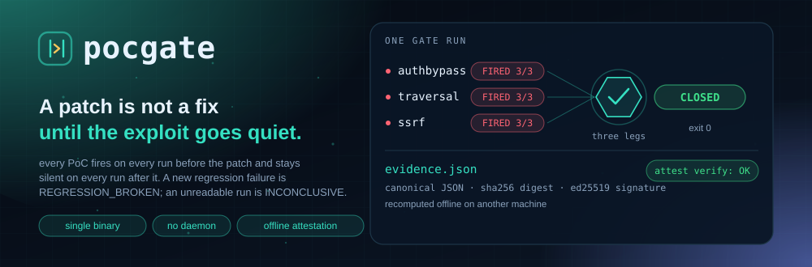
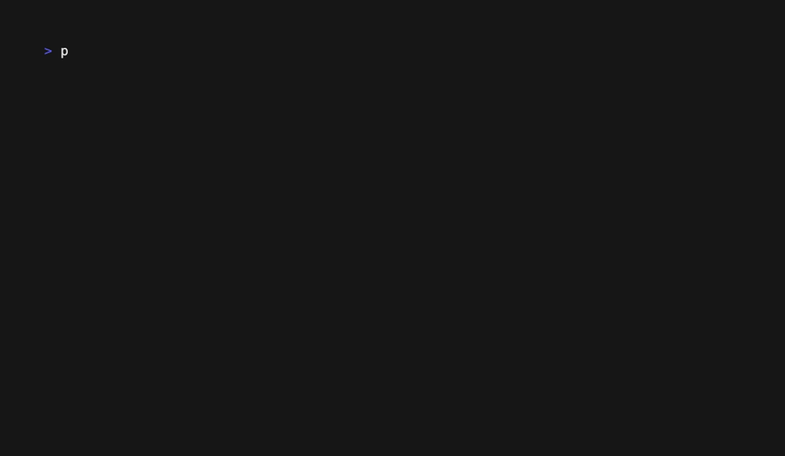

<p align="center"><b>English</b> · <a href="./README.md">简体中文</a></p>

<p align="center">
  <picture>
    <source media="(prefers-color-scheme: dark)" srcset="assets/hero-dark.svg">
    <source media="(prefers-color-scheme: light)" srcset="assets/hero-light.svg">
    
  </picture>
</p>

<p align="center">
  
</p>

<p align="center">
  <a href="https://github.com/SuperMarioYL/pocgate/releases"></a>
  <a href="./LICENSE"></a>
  
  
  
  
</p>

<p align="center">
  <a href="#install">Install</a> ·
  <a href="#quickstart">Quickstart</a> ·
  <a href="#demo">Demo</a> ·
  <a href="#commands">Commands</a> ·
  <a href="#configuration">Configuration</a> ·
  <a href="#capabilities-and-limits">Capabilities</a> ·
  <a href="#pricing-and-enterprise">Pricing</a> ·
  <a href="#roadmap">Roadmap</a>
</p>

**pocgate is a closure gate for patches: it answers "is this fix actually a fix?" with evidence that can be recomputed.**

Once an agent has written the patch, the question in the review is not whether the diff looks right. It is "how do you know the vulnerability is closed?". pocgate turns that into a repeatable measurement: fire the PoCs against the vulnerable build, apply the patch in a scratch copy and watch them go quiet, keep the regression suite green, then sign an `evidence.json` — one file and one public key are enough to recompute the same verdict on another machine, offline.

One binary, no daemon, no database, no network, no model calls.

---

##  The problem: the patch passed review, the flaw is still there

"The PoC no longer fires after the patch" proves nothing on its own. At least three situations make that sentence true while the vulnerability remains:

- **The PoC never hit.** Wrong endpoint, missing precondition, an authenticated route where `curl -f` turns a 401 into a non-zero exit — the script went quiet without ever proving anything.
- **The build is broken.** The service never started, it answers 500, the port refuses connections; the PoC does not fire either. Reading "non-zero exit" as "safe" reads a broken build as a fix.
- **Noise passed for a result.** One hit in three runs, or a patch that was never measured against a working repro.

On a pipeline all three look identical: one line saying "did not fire". pocgate splits the conclusion into three legs that must all hold, and it demands certainty before the patch as well — if a PoC did not fire on every pre-patch run, the verdict is `INCONCLUSIVE` and the gate refuses to continue.

pocgate does not write the patch. Your local agent does, running on local inference (Qwen3-Coder on Ollama, DeepSeek on vLLM, or whatever your team serves); pocgate does not call the model, generate PoCs, or edit code. It judges and attests. In an air-gapped network that division is a hard constraint: if inference can be local, so must the verdict and the evidence.

For the delivery side there is a second use. A compliance review never accepts "I reviewed the diff"; it wants proof that the fix is done. `evidence.json` is something you can hand to an assessor and let them recompute themselves.

##  One decision: a three-leg conjunction

```
CLOSED  ⇔  every PoC fired on every pre-patch run (repeats out of repeats)
        ∧  no PoC fires on any post-patch run, and every run ended in the declared silent_exit
        ∧  the regression failure set gained nothing
```

Anything missing is not `CLOSED`. That is the line between this and a tool that only reports "the PoC does not fire after the patch": the latter cannot tell a fix from a PoC that hit nothing.

There are four verdicts, and each one is also the process exit code:

| Verdict | Exit | Meaning |
| --- | --- | --- |
| `CLOSED` | 0 | all three legs hold |
| `STILL_VULNERABLE` | 1 | at least one PoC still fires after the patch |
| `REGRESSION_BROKEN` | 2 | PoCs are green, but the regression set gained a failure |
| `INCONCLUSIVE` | 3 | a leg could not be observed: no baseline, build failure, or a PoC run that counted as neither a fire nor a declared silence |

When several things go wrong at once the reported verdict follows `STILL_VULNERABLE` > `REGRESSION_BROKEN` > `INCONCLUSIVE`.

### The three-state PoC contract

A PoC is not binary. `fired_when` in `pocgate.yaml` is where you declare the contract:

| Exit code | What the PoC is saying | Recorded as |
| --- | --- | --- |
| `fired_when.exit` (default 0) | the flaw reproduced | `FIRED`, counted in `fired/repeats` |
| `fired_when.silent_exit` (must be declared) | the target gave a definite, non-exploitable answer (401/403/400) | `SILENT` |
| anything else | crash, 500, timeout, unreachable — nothing was proven | `UNOBSERVED`, which forces `INCONCLUSIVE` |

This is why the PoCs in this repo never use `curl -f`: it collapses a 401 and a dead service into the same non-zero exit. They read the HTTP status and dispatch their own exit code instead — copy that shape.

`repeats` defaults to 3 and is run on both sides; only a full sweep on both counts. The evidence stores integer `fired` and `repeats`, so the hit rate is derived as `fired/repeats` and the file stays readable by `jq` without a parser for strings like "3/3".

##  Architecture

```
cmd/pocgate            init · doctor · baseline · verify · demo · attest verify
  internal/spec        parses and validates pocgate.yaml (the only schema owner; unknown fields rejected)
  internal/exec        the only package that touches processes: build, start the service, wait for TCP,
                       kill the process group, record exit code and stdout digest
  internal/oracle      runs each PoC N times, classifies FIRED / SILENT / UNOBSERVED, writes the baseline
  internal/regress     runs the regression command, extracts failures via exit_code or junit_xml
  internal/verdict     three observations → four verdicts + exit codes; patches applied in a scratch copy
  internal/evidence    canonical JSON, sha256 digest, ed25519 signing and offline verification
  internal/demo        go:embed synthetic target expanded into a temp dir, plus the demo orchestration
```

Because `exec` is the only process boundary, timeouts, process-group cleanup, output bounding and digests have exactly one implementation.

All state on disk:

```
.pocgate/baseline.json            the vulnerable build's observation (spec digest, tree digest, every run)
.pocgate/evidence/latest.json     the signed closure evidence; the sibling .pub is the signing public key
~/.pocgate/key                    local ed25519 private key, created on first signing, mode 0600
```

There is no server. `pocgate verify` works in a copy under `$TMPDIR`: patch, rebuild, replay, delete; nothing outside `.pocgate/` (the evidence and its public key) is written to your working tree.

##  Install

Go 1.24+ to build. One dependency (`gopkg.in/yaml.v3`, pinned in `go.mod` / `go.sum`); the binary carries the Go runtime, so **running the `pocgate` binary itself** needs no Go. `pocgate demo` and Go-target builds do need `go`, every spec command runs through `sh`, patches are applied with `patch`, and the bundled PoCs use `curl`.

```bash
git clone https://github.com/SuperMarioYL/pocgate.git
cd pocgate
go build -trimpath -ldflags "-s -w" -o pocgate ./cmd/pocgate
install -m 0755 pocgate /usr/local/bin/pocgate   # or scp it into the air-gapped host
```

**Air-gapped install**, easiest first:

1. Tagging `v*` makes the release workflow publish `pocgate_<version>_<os>_<arch>.tar.gz` (linux/darwin × amd64/arm64). Copy it in and unpack; `pocgate version` and `attest verify` need no Go, while `demo` and Go-target builds also need `go`, `sh`, `patch`, and `curl`.
2. On a connected machine of the same architecture, `go mod vendor`, copy the whole repository including `vendor/`, then `GOFLAGS=-mod=vendor go build ./...` inside the air gap. No proxy involved.
3. Module cache only: `go mod download`, then copy `$GOMODCACHE` as well. This is the most error-prone of the three; prefer the first two.

Check the machine before anything else:

```bash
pocgate doctor
```

It reports `sh` and `patch` (required), Go and curl, whether `pocgate.yaml` is valid, whether the service port is free, and whether the signing key is usable. A missing `pocgate.yaml` is only a warning — the intended order is `doctor` before `init`.

##  Quickstart

### First minute: run the bundled target

`demo` compiles the bundled target and runs the regression suite locally, so it needs `go`, `sh`, `patch`, and `curl`; the `pocgate` binary itself needs no Go.

```bash
pocgate demo
```

It runs the bundled synthetic target end to end: three PoCs each `FIRED 3/3` on the vulnerable build, each `SILENT 0/3` after the good patch, no new regression — `CLOSED`. Then two deliberately bad patches produce `STILL_VULNERABLE` and `REGRESSION_BROKEN`; finally it writes the signed `evidence.json` and prints the `pocgate attest verify` command.

### From the second minute: your own target

```bash
cd /path/to/your-service
pocgate init                  # writes a commented pocgate.yaml
$EDITOR pocgate.yaml          # target / oracles / regression / labels
pocgate baseline              # build, start the service, run each PoC 3 times, record the baseline
```

`baseline` writes only when every PoC fired on every run. Otherwise it prints which PoC missed, exits `INCONCLUSIVE`, and deletes the previous baseline so a stale claim cannot be consumed later.

With the agent's patch in hand, **do not leave the change in the target tree**: `verify` requires the working tree to match the tree digest captured by `baseline` exactly, and a changed tree is `INCONCLUSIVE`. Export the diff from a separate clone / worktree, or revert the applied change first:

```bash
# export the patch from the agent's own clone / worktree; the target tree stays as it was at baseline
git -C /path/to/agent-fix diff > /tmp/fix.diff    # git style, with a/ and b/ prefixes

# if the change is already applied in the current tree, put the tree back to the baseline commit
git stash                                          # or git checkout -- .

pocgate verify --patch /tmp/fix.diff               # apply in a scratch copy, rebuild, replay
pocgate attest verify --pubkey /secure/signer.pub .pocgate/evidence/latest.json
```

Outside `.pocgate/` (the evidence and its public key), `verify` writes nothing to your working tree. It refuses, as `INCONCLUSIVE`: a patch that edits `pocgate.yaml`, a patch that edits a PoC, and a working tree that changed after `baseline` was captured (that baseline describes different files).

The public key for `attest verify` must come from you: a `.pub` sitting next to the evidence only proves the two files agree, and whoever can rewrite one can rewrite the other. In practice the key travels over another channel — a USB stick, configuration management, or a fingerprint on the intranet wiki.

##  Demo

<p align="center">
  
</p>

This is a real terminal recording of `assets/demo.tape` made with [vhs](https://github.com/charmbracelet/vhs), uncut. On the recording machine (darwin/arm64, Go 1.24.1) the whole `pocgate demo` took **9.4 seconds**: 36 PoC executions, 6 regression runs, 4 builds.

The target is a small HTTP service with three independent synthetic flaws:

| PoC | Flaw | What firing looks like |
| --- | --- | --- |
| `authbypass` | `/admin` checks no credential at all | `ADMIN-ACTION-ALLOWED` |
| `traversal` | `/file?path=` joins the caller's path, so `../` leaves the public root | `SHOP-INTERNAL-SECRET` from outside the root |
| `ssrf` | `/fetch?url=` may point at the service's own internal endpoint | `INTERNAL-ONLY` |

The three patches show three of the four verdicts: the good patch satisfies all legs → `CLOSED`; the partial patch fixes traversal and SSRF but leaves `/admin` open → `STILL_VULNERABLE`; the patch that fixes everything but adds a test asserting the old behaviour → `REGRESSION_BROKEN`.

The real output of that run — per-verdict counts and the evidence structure — is in [`docs/demo-results.json`](docs/demo-results.json). The counts, verdicts, and structure are comparable with your own run; the recorded digest and public key belong to that recording (per-run timestamps, a key generated on that machine) and cannot be reproduced. It is a synthetic target: it proves the mechanism, not coverage of real components.

##  Commands

```
pocgate init [--force]
pocgate doctor [--spec path] [--json]
pocgate baseline [--spec path]
pocgate verify --patch <diff> [--spec path] [--json] [--fail-on <verdict>]
pocgate attest verify --pubkey <key> <evidence.json>
pocgate demo [--evidence path]
pocgate help | version
```

### `init`

Writes a commented `pocgate.yaml` into the current directory with the four blocks: `target`, `oracles`, `regression`, `labels`. It refuses to overwrite an existing file unless `--force`. The PoC paths it names are yours to create — writing a PoC that really proves a flaw is human work, not scaffolding.

### `doctor`

Readiness check, well under a second normally. `--json` prints the same report for machines. Exit: `0` when everything passes or only warns; `78` when `pocgate.yaml` is invalid; `70` when `patch`/`sh` is missing, the port is taken, or the signing key is unusable.

### `baseline`

Build → start the service → run each PoC `repeats` times → write `.pocgate/baseline.json`. If any PoC did not fire on every run, it returns `INCONCLUSIVE` (exit 3) and refuses to write. Output looks like:

```
authbypass: FIRED 3/3 (exit 0, 200ms) — baseline captured
```

### `verify`

Applies the patch in a scratch copy, rebuilds, replays the PoCs and the regression command, writes `.pocgate/evidence/latest.json` plus its `.pub`, and exits with the verdict (0/1/2/3).

- `--patch` is required and must be a git-style unified diff. `git diff` produces it; a bare `diff -u` has no leading path component for `patch -p1` to strip, and pocgate rejects it before trying.
- `--json` prints the evidence document to stdout as one canonical JSON line, for downstream tools. When there is no document to write it prints `{"verdict":"INCONCLUSIVE","error":"..."}`.
- `--fail-on` collapses the four states into a CI 0/1 gate, ordered by closure risk: `CLOSED` < `REGRESSION_BROKEN` < `STILL_VULNERABLE` < `INCONCLUSIVE`. An unobservable run is the riskiest outcome, because a gate that cannot see the target must never be green.

| `--fail-on` | exits 1 (blocked) | exits 0 (passes) |
| --- | --- | --- |
| `REGRESSION_BROKEN` | `REGRESSION_BROKEN` / `STILL_VULNERABLE` / `INCONCLUSIVE` | `CLOSED` |
| `STILL_VULNERABLE` | `STILL_VULNERABLE` / `INCONCLUSIVE` | `CLOSED` / `REGRESSION_BROKEN` |
| `INCONCLUSIVE` | `INCONCLUSIVE` | `CLOSED` / `REGRESSION_BROKEN` / `STILL_VULNERABLE` |

The smallest CI step:

```yaml
- name: closure gate
  run: pocgate verify --patch fix.diff --json --fail-on REGRESSION_BROKEN
```

Mind the direction: lower closure risk is safer, so **a lower threshold is stricter**. `REGRESSION_BROKEN` blocks `REGRESSION_BROKEN`, `STILL_VULNERABLE`, and `INCONCLUSIVE`; `INCONCLUSIVE` is the loosest, blocking only `INCONCLUSIVE` and letting `STILL_VULNERABLE` through.

### `attest verify`

```
pocgate attest verify --pubkey <key> <evidence.json>
```

Recomputes the sha256 digest of the canonical bytes, verifies the ed25519 signature, and checks that the file is byte-for-byte the canonical form — one changed byte fails. Fully offline, no clock, no network. `--pubkey` is required; exit 0 verified, 1 failed, 64 usage.

### `demo`

Runs the bundled target from red to green, including the two counterexamples, and writes signed evidence. It needs no `pocgate.yaml`, no network, and writes nothing outside `.pocgate/`. `--evidence` moves where the evidence lands.

### Exit codes

| Code | Meaning |
| --- | --- |
| 0 | `CLOSED`, or a plain success (`help`, `version`, a clean `doctor`) |
| 1 | `STILL_VULNERABLE`; for `attest verify`, verification failed |
| 2 | `REGRESSION_BROKEN` |
| 3 | `INCONCLUSIVE`; also what `baseline` returns when it refuses to write |
| 64 | usage error: missing argument, unknown flag, patch cannot apply, `init` refusing to overwrite |
| 70 | tool or environment failure (not your input) |
| 78 | configuration error: `pocgate.yaml` missing, invalid, or unreadable |

Verdict codes stay inside 0–3 and CLI failures start at 64, so a gate script can tell "the patch is bad" from "the tool did not run".

##  Configuration

One `pocgate.yaml` describes one target. Every relative path resolves against the directory of that file, and every command runs there.

```yaml
# what to build, which PoCs prove the flaw, how to check for regressions.
target:
  name: shop                          # appears in reports and evidence
  build: go build ./...               # exit 0 means the build succeeded
  build_timeout_sec: 300              # default 300
  service:                            # keep when the target runs a process; delete the block when PoCs build their own
    cmd: ./shop                       # pocgate waits for TCP, then kills the whole process group at the end
    port: 18081                       # readiness is a TCP connect to 127.0.0.1:<port>
    ready_timeout_sec: 20             # default 20
    env:
      LISTEN_ADDR: 127.0.0.1:18081

oracles:
  - id: authbypass                    # identifier in reports and evidence; must be unique
    poc: pocs/authbypass.sh           # executable; without the exec bit it is run through sh
    repeats: 3                        # default 3; run this many times on each side
    timeout_sec: 60                   # default 60; the budget for all of this oracle's repeats
    env:
      POCGATE_TARGET_URL: http://127.0.0.1:18081
    fired_when:
      exit: 0                         # default 0: "the flaw reproduced"
      silent_exit: 1                  # must differ from exit: "the target gave a definite no"
      stdout: 'ADMIN-ACTION-ALLOWED'  # optional: stdout must also match for a fire

regression:
  cmd: go test ./...
  parser: exit_code                   # exit_code | junit_xml; defaults to exit_code when cmd is set

labels:
  cve: CVE-2026-00000                 # recorded verbatim
  technique: T1078                    # optional ATT&CK id, filled in by the operator; never inferred
```

Rules that bite:

- **Unknown fields are rejected.** A typo cannot silently disable a check; the spec fails to load (exit 78).
- **`silent_exit` is optional, but without it `CLOSED` is unreachable.** Any non-fire exit stays `UNOBSERVED` — deliberately, because a crash and a fix look the same in an exit code.
- **`junit_xml` reads the report from stdout.** v0.1 has no report-path field, so the command must print the XML.
- **`exit_code` treats the whole command as one check.** `Total` is 1 and a non-zero exit yields one `exit:<code>` failure — enough to detect a new failure.
- **A patch may not touch `pocgate.yaml` or a PoC.** That would be a different observation, so the verdict is `INCONCLUSIVE`.
- **The baseline's tree digest must match the tree `verify` copies.** If anything changed outside the patch, re-run `baseline`.

##  Capabilities and limits

| Capability | v0.1 |
| --- | --- |
| Three-leg conjunction, four verdicts, exit codes | implemented |
| N repeats per side with three-state classification | implemented |
| Patch applied in a scratch copy, no writes outside `.pocgate/` | implemented |
| Baseline tree / spec / PoC digest consistency checks | implemented |
| Canonical JSON + sha256 + ed25519 signing and offline verification | implemented |
| `--json` and `--fail-on` for CI | implemented |
| `init` / `doctor` / bundled `demo` | implemented |
| JUnit report files (instead of stdout) | roadmap |
| Container / VM sandbox orchestration (`--sandbox docker`) | roadmap |
| Windows target process management | builds (the release workflow produces Windows binaries), but v0.1 only promises Linux/macOS start/stop semantics |
| Writing patches, generating PoCs, calling models | out of scope |
| SARIF / third-party report adapters | roadmap |
| Web UI, multi-user, RBAC, server | enterprise, not in v0.1 |

Limits, next to what they affect:

- `demo` runs a **synthetic target**. It proves the mechanism works; it does not prove coverage of real components or vendor middleware. A real conclusion needs your own CVE and your own PoC.
- The repository contains **no working exploit for a real CVE**, only synthetic flaws. Real PoCs stay inside your network.
- `verify` isolates by **temporary directory**, not by container. Which sandbox you run it in is your call; pocgate only guarantees that the observation is reproducible.
- Applying a patch depends on the system `patch`; commands run through `sh -c`, and service start/stop is built on POSIX process groups. The release workflow also produces a Windows binary, but there only the direct child can be signalled, so targets that need a service are best run on Linux or macOS.
- The evidence proves "in this observation, these PoCs behaved like this". It does not prove the PoCs cover every exploitation path of the CVE — that is on the PoC you write.

##  Pricing and enterprise

The CLI is Apache-2.0-licensed and free to use. The oracle and the `evidence.json` format must stay free: an assessor has to be able to read the evidence without buying a licence first, otherwise the format can never become a standard.

The money is in private delivery. **v0.1 does not include the enterprise edition**; the table below is the pilot and procurement shape, not shipped features:

| Offering | Scope | Price |
| --- | --- | --- |
| Pilot | you bring one in-house Java/Go CVE with an existing PoC; we produce `evidence.json` on your air-gapped host and `attest verify` it on a second machine | ¥20,000 / 30 days, creditable against an annual licence |
| Enterprise | render `evidence.json` into an assessment-ready remediation pack (compliance template), multi-project ledger, audit trail, offline licence, maintenance | ¥68,000 / year / organisation (up to 5 projects, one upgrade included) |
| OEM white label | integrators deliver under their own brand, proving the same patch in many isolated environments | ¥200,000 / year + ¥8,000 per delivery |

No per-seat pricing (the buyer is an organisation), no hosted SaaS (it contradicts the air gap). The offline licence reuses the evidence signing code; expiry degrades features, it never locks data. The first customer gets a PDF quote and a bank transfer.

Integrators pay before the end customer: the same patch has to be proven again and again across isolated environments, and reproducible evidence cuts rework and acceptance arguments — while they already have a contract channel that does not require us to clear vendor registration or a tender.

##  Roadmap

- **v0.1 (current)** three-leg conjunction, four verdicts, signed evidence, offline verification, `--json` / `--fail-on`, `init` / `doctor` / `demo`.
- **Next** JUnit report files, SARIF and third-party Trust Report adapters, `--sandbox docker`, batched runs archived per project.
- **Enterprise** remediation pack rendering, multi-project ledger, audit trail, offline licence and maintenance.
- **Later** more regression parsers, Windows target support.
- **Never** LLM-generated PoCs or auto-fix loops, bundled real exploits, coverage reachability analysis, hosted service.

Nothing on the roadmap is implemented, and this README does not present it as capability.

##  Development

```bash
GOPROXY=off go build ./...
go vet ./...
gofmt -l .                 # should print nothing
GOPROXY=off go test -race ./...
```

`pocgate demo` and the end-to-end tests need `sh`, `patch`, `curl` and Go. CI runs on ubuntu with Go 1.24 and checks gofmt, vet, `-race` tests and the build.

The layout is the architecture section above; `internal/demo/fixtures/shop` is the bundled target, and its `pocgate.yaml`, `main.go`, three PoCs and `patch.diff` form a minimal example worth copying.

<p align="center"><sub><a href="./LICENSE">Apache-2.0</a> © 2026 SuperMarioYL</sub></p>
