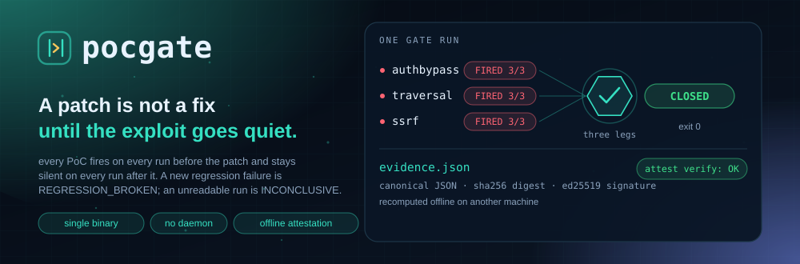
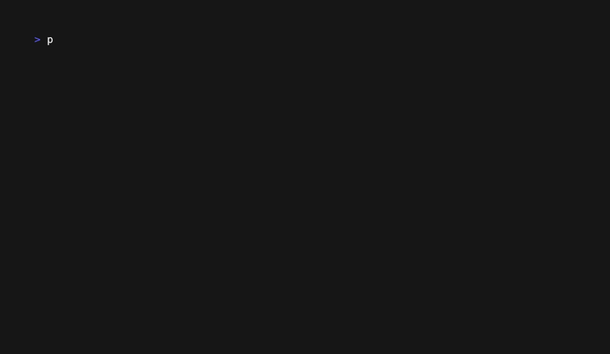

<p align="center"><a href="./README.en.md">English</a> · <b>简体中文</b></p>

<p align="center">
  <picture>
    <source media="(prefers-color-scheme: dark)" srcset="assets/hero-dark.svg">
    <source media="(prefers-color-scheme: light)" srcset="assets/hero-light.svg">
    
  </picture>
</p>

<p align="center">
  
</p>

<p align="center">
  <a href="https://github.com/SuperMarioYL/pocgate/releases"></a>
  <a href="./LICENSE"></a>
  
  
  
  
</p>

<p align="center">
  <a href="#安装">安装</a> ·
  <a href="#快速开始">快速开始</a> ·
  <a href="#演示">演示</a> ·
  <a href="#命令">命令</a> ·
  <a href="#配置">配置</a> ·
  <a href="#能力与边界">能力与边界</a> ·
  <a href="#付费与企业版">付费</a> ·
  <a href="#路线图">路线图</a>
</p>

**pocgate 是一道补丁闭合门禁：它用可复算的执行证据，回答「这个补丁到底修没修好」。**

Agent 把补丁写出来之后，评审会上的问题不是「diff 看着对不对」，而是「你怎么知道漏洞已经关掉了」。pocgate 把这个问题变成一次可重放的测量：在漏洞构建上把 PoC 打红，在临时副本里应用补丁后重跑转绿，回归保持绿，最后签出一份 `evidence.json`——换一台机器、断网、只拿这一个文件和一把公钥，就能重算出同样的结论。

单二进制，无守护进程，无数据库，不联网，不调模型。

---

##  问题：补丁通过了评审，漏洞还在

「补丁之后 PoC 不再触发」这句话单独拿出来，证明不了任何事。至少三种情况会让它成立，而漏洞仍然存在：

- **PoC 本来就没打中。** 入口选错、少了前置状态、需要登录的接口被 `curl -f` 把 401 吃成一个非零退出——脚本「安静」了，其实从未证明过什么。
- **构建其实挂了。** 服务没起来、返回 500、端口连不上，PoC 同样不会触发。把「非零退出」读成「安全」，就是把一个坏构建读成一次修复。
- **抖动的结果被当成结论。** 三次里中一次，或者补丁前根本没跑满，就宣布修好了。

这三种情况在流水线上看起来一模一样：都只有一句「没触发」。pocgate 的处理方式是把结论拆成必须同时成立的三段，并且要求补丁前就打出确定性——补丁前没有每次触发，直接判 `INCONCLUSIVE`，拒绝继续。

补丁本身不由 pocgate 写。它由你内网的 Agent 写，跑在本地推理上（Ollama 上的 Qwen3-Coder、vLLM 上的 DeepSeek，或团队自己的模型）；pocgate 不调模型、不生成 PoC、不改代码，只负责判定与举证。这个分工在气隙环境里是硬约束：推理可以本地部署，判定与证据也必须能离线复算。

对交付方，这条链还有第二个用处：等保整改要交的从来不是「我审过 diff」，而是「修复已完成」的举证。`evidence.json` 是可以递给测评方、让对方自己重算一遍的东西。

##  判定只有一条：三段合取

```
CLOSED  ⇔  补丁前每个 PoC 都触发（repeats 次全中）
        ∧  补丁后每个 PoC 都不触发，且每一次都是声明的 silent_exit
        ∧  回归失败集没有新增
```

少任何一段都不是 `CLOSED`。这就是它与「只报补丁后不触发」的工具的分界线：后者无法区分「漏洞修好了」和「PoC 打了空气」。

判定结果只有四态，同时就是进程退出码：

| 判定 | 退出码 | 含义 |
| --- | --- | --- |
| `CLOSED` | 0 | 三段全部成立 |
| `STILL_VULNERABLE` | 1 | 补丁后至少有一个 PoC 仍然触发 |
| `REGRESSION_BROKEN` | 2 | PoC 全绿，但回归失败集新增了条目 |
| `INCONCLUSIVE` | 3 | 有一段观察不到：没 baseline、构建失败、PoC 跑了但既不算触发也不算沉默 |

同一轮里出现多个问题时，报告顺序是 `STILL_VULNERABLE` > `REGRESSION_BROKEN` > `INCONCLUSIVE`。

### PoC 的三态契约

一个 PoC 不是「触发 / 没触发」两态，而是三态。`pocgate.yaml` 里的 `fired_when` 就是在声明这条契约：

| 退出码 | PoC 在说什么 | 证据里记成 |
| --- | --- | --- |
| `fired_when.exit`（默认 0） | 漏洞复现了 | `FIRED`，计入 `fired/repeats` |
| `fired_when.silent_exit`（必须显式声明） | 目标给了确定的、不可利用的回答（如 401/403/400） | `SILENT` |
| 其它任何退出码 | 崩溃、500、超时、连不上——什么都没证明 | `UNOBSERVED`，直接导致 `INCONCLUSIVE` |

所以 PoC 里不要用 `curl -f`：它把 401 变成一个非零退出，和「服务挂了」混成同一件事。仓库自带的三个 PoC 都是读 HTTP 状态码再分派退出码的，可以直接当模板抄。

`repeats` 默认 3，补丁前后各跑满，前后都全中才算数。证据里存的是整数 `fired`、`repeats`，命中率由 `fired/repeats` 派生，因此 `evidence.json` 能被 `jq` 直接解析，不需要为「3/3」写字符串解析器。

##  架构

```
cmd/pocgate            init · doctor · baseline · verify · demo · attest verify
  internal/spec        解析并校验 pocgate.yaml（唯一 schema 所有者，未知字段直接拒绝）
  internal/exec        唯一碰进程的模块：构建、起服务、等 TCP 就绪、按进程组停掉、记退出码与 stdout 摘要
  internal/oracle      按 spec 跑每个 PoC N 次，判 FIRED / SILENT / UNOBSERVED，落 baseline
  internal/regress     跑回归命令，按 exit_code 或 junit_xml 提取失败集
  internal/verdict     三段观察 → 四态 + 退出码；补丁在临时副本里应用与重建
  internal/evidence    规范化 JSON、sha256 摘要、ed25519 签名与离线校验
  internal/demo        go:embed 三个合成缺陷的靶场，展开到临时目录并编排整条链
```

`exec` 是唯一接触进程的模块，oracle 与 regress 都经它执行，所以超时、进程组清理、输出截断与摘要只有一份实现。

磁盘上的状态只有三处：

```
.pocgate/baseline.json            漏洞构建的观察（spec 摘要 + 源码树摘要 + 每个 PoC 的每次运行）
.pocgate/evidence/latest.json     签名的闭合证据；同名 .pub 是本次签名的公钥
~/.pocgate/key                    本地 ed25519 私钥，首次签名时生成，权限 0600
```

没有服务端。`pocgate verify` 在 `$TMPDIR` 下的副本里工作：应用补丁、重建、重跑，结束即删除；工作区除 `.pocgate/`（证据与公钥）外不会被写。

##  安装

要求 Go 1.24+。构建只需要一个依赖（`gopkg.in/yaml.v3`，版本锁在 `go.mod` / `go.sum`），产出的二进制自带 Go 运行时：**运行 `pocgate` 二进制本身**不需要 Go；但 `pocgate demo` 与 Go 目标的构建需要 `go`，所有 spec 命令经 `sh` 执行、补丁用 `patch` 应用、随包 PoC 用 `curl`。

```bash
git clone https://github.com/SuperMarioYL/pocgate.git
cd pocgate
go build -trimpath -ldflags "-s -w" -o pocgate ./cmd/pocgate
install -m 0755 pocgate /usr/local/bin/pocgate   # 或直接 scp 进内网机器
```

**气隙环境**有三条路，按省事程度排：

1. 打 `v*` 标签时 release 工作流会产出 `pocgate_<version>_<os>_<arch>.tar.gz`（linux/darwin × amd64/arm64），拷进去解压即可；运行 `pocgate version` 与 `attest verify` 不需要 Go，`demo` 与 Go 目标构建另需 `go`、`sh`、`patch`、`curl`。
2. 在有网的同架构机器上 `go mod vendor`，把整个仓库目录（含 `vendor/`）拷进内网，用 `GOFLAGS=-mod=vendor go build ./...` 构建，全程不需要代理。
3. 只带模块缓存：`go mod download` 后把 `$GOMODCACHE` 一起拷过去。这是三条里最容易出错的一条，前两条优先。

装完先体检：

```bash
pocgate doctor
```

它检查 `sh` 与 `patch`（必需的）、Go 与 curl、`pocgate.yaml` 是否合法、服务端口是否被占用、签名密钥是否可用。缺 `pocgate.yaml` 只是警告——正常顺序是先 `doctor` 再 `init`。

##  快速开始

### 第一分钟：跑随包靶场

`demo` 会在本机编译随包靶场并执行回归，需要 `go`、`sh`、`patch` 与 `curl`；`pocgate` 二进制本身不需要 Go。

```bash
pocgate demo
```

它把随包的合成靶场跑一遍：三个 PoC 在漏洞构建上各 `FIRED 3/3`，套上好补丁后各 `SILENT 0/3`，回归无新增，判 `CLOSED`；随后两条故意做坏的补丁分别得到 `STILL_VULNERABLE` 和 `REGRESSION_BROKEN`；最后写出签名证据 `evidence.json` 并打印 `pocgate attest verify` 复核命令。

### 第二分钟起：换成你自己的目标

```bash
cd /path/to/your-service
pocgate init                  # 写一份带注释的 pocgate.yaml
$EDITOR pocgate.yaml          # target / oracles / regression / labels
pocgate baseline              # 构建、起服务、每个 PoC 跑 3 次，落 baseline
```

`baseline` 只有在每个 PoC 每次运行都触发时才写盘；否则它打印是哪个 PoC 没打中，返回 `INCONCLUSIVE`，并删掉上一轮的旧 baseline，避免留下过期结论。

拿到 Agent 的补丁后，**不要把改动直接留在目标树里**：`verify` 要求工作树与 `baseline` 时的源码摘要完全一致，改过就判 `INCONCLUSIVE`。在单独一份 clone / worktree 里导出补丁，或者先撤掉已应用的改动：

```bash
# 在 Agent 自己的 clone / worktree 里导出补丁；目标树保持 baseline 时的状态
git -C /path/to/agent-fix diff > /tmp/fix.diff    # 必须是 git 风格、带 a/ b/ 前缀

# 如果改动已经落在当前树：先撤回，让树回到 baseline 时的提交
git stash                                          # 或 git checkout -- .

pocgate verify --patch /tmp/fix.diff               # 临时副本里应用、重建、重跑
pocgate attest verify --pubkey /secure/signer.pub .pocgate/evidence/latest.json
```

`verify` 除 `.pocgate/`（证据与公钥）外不写你的工作区。它会拒绝这几类输入，全部落在 `INCONCLUSIVE`：补丁改动了 `pocgate.yaml`、补丁改动了 PoC 本身、工作区在 `baseline` 之后变过（说明基线描述的不是这份代码）。

`attest verify` 的公钥要你自己给：和证据放在一起的 `.pub` 只能证明文件之间自洽，能改证据的人也能改它。真实用法是把公钥从另一条通道带过去——U 盘、配置管理系统、或者刻在内网 wiki 上的指纹。

##  演示

<p align="center">
  
</p>

这段是 `assets/demo.tape` 用 [vhs](https://github.com/charmbracelet/vhs) 录的真实终端输出，没有剪辑。录制机上（darwin/arm64、Go 1.24.1）整轮 `pocgate demo` 耗时 **9.4 秒**：36 次 PoC 执行、6 次回归执行、4 次构建。

靶场是一个 HTTP 小服务，三个互相独立的合成缺陷：

| PoC | 缺陷 | 触发时看到什么 |
| --- | --- | --- |
| `authbypass` | `/admin` 不校验任何凭据 | `ADMIN-ACTION-ALLOWED` |
| `traversal` | `/file?path=` 直接拼接，`../` 逃出公开目录 | 目录外的 `SHOP-INTERNAL-SECRET` |
| `ssrf` | `/fetch?url=` 可以指向服务自己的内部端点 | `INTERNAL-ONLY` |

这三条补丁分别演示四态里的三种：好补丁三段齐全 → `CLOSED`；只修了遍历与 SSRF、`/admin` 照旧开放 → `STILL_VULNERABLE`；全部修好但顺手加了一个断言旧行为的测试 → `REGRESSION_BROKEN`。

同一轮的真实输出、每次判定的计数与证据结构都记在 [`docs/demo-results.json`](docs/demo-results.json) 里；计数、判定与结构可以和你的运行对照，但证据里的摘要和公钥属于那一次录制（每次运行的时间戳不同、密钥按机器生成），不能复现。这是合成靶场，它证明的是机制，不是「覆盖了真实组件」。

##  命令

```
pocgate init [--force]
pocgate doctor [--spec path] [--json]
pocgate baseline [--spec path]
pocgate verify --patch <diff> [--spec path] [--json] [--fail-on <verdict>]
pocgate attest verify --pubkey <key> <evidence.json>
pocgate demo [--evidence path]
pocgate help | version
```

### `init`

在当前目录写一份带注释的 `pocgate.yaml`，四个块：`target`、`oracles`、`regression`、`labels`。已有同名文件时拒绝覆盖，除非 `--force`。模板里指向的 PoC 路径需要你自己创建——写一个真正能证明漏洞的 PoC 是人的工作，不是脚手架能生成的。

### `doctor`

体检，正常情况亚秒级。`--json` 输出机器可读的同一份结果。退出码：全部通过或只有警告 `0`；`pocgate.yaml` 不合法 `78`；缺少 `patch`/`sh`、端口被占用、签名密钥损坏 `70`。

### `baseline`

构建 → 起服务 → 每个 PoC 跑 `repeats` 次 → 写 `.pocgate/baseline.json`。任一 PoC 没有每次都触发就返回 `INCONCLUSIVE`（退出码 3）并拒绝写盘。输出形如：

```
authbypass: FIRED 3/3 (exit 0, 200ms) — baseline captured
```

### `verify`

在临时副本里应用补丁、重建、重跑 PoC 与回归，然后写 `.pocgate/evidence/latest.json` 与其 `.pub`，退出码就是判定（0/1/2/3）。

- `--patch` 必填，必须是 git 风格 unified diff。`git diff` 直接产出；`diff -u` 的裸输出没有可剥离的路径分量，`patch -p1` 找不到目标文件，pocgate 会在应用前就报错退出。
- `--json` 把证据文档打到 stdout（单行规范 JSON），适合喂给下游；没有证据可写时输出 `{"verdict":"INCONCLUSIVE","error":"..."}`。
- `--fail-on` 把四态收成 CI 的 0/1 门禁，阈值按「闭合风险」排序：`CLOSED` < `REGRESSION_BROKEN` < `STILL_VULNERABLE` < `INCONCLUSIVE`。`INCONCLUSIVE` 风险最高，因为看不清楚的目标绝不能放行。

| `--fail-on` | 退出 1（拦下） | 退出 0（放行） |
| --- | --- | --- |
| `REGRESSION_BROKEN` | `REGRESSION_BROKEN` / `STILL_VULNERABLE` / `INCONCLUSIVE` | `CLOSED` |
| `STILL_VULNERABLE` | `STILL_VULNERABLE` / `INCONCLUSIVE` | `CLOSED` / `REGRESSION_BROKEN` |
| `INCONCLUSIVE` | `INCONCLUSIVE` | `CLOSED` / `REGRESSION_BROKEN` / `STILL_VULNERABLE` |

接进 CI 的最小写法：

```yaml
- name: closure gate
  run: pocgate verify --patch fix.diff --json --fail-on REGRESSION_BROKEN
```

注意阈值方向：闭合风险越低越安全，因此**阈值定得越低越严格**。`REGRESSION_BROKEN` 会同时拦下 `REGRESSION_BROKEN`、`STILL_VULNERABLE` 与 `INCONCLUSIVE`；`INCONCLUSIVE` 最宽松，只拦 `INCONCLUSIVE`，会把 `STILL_VULNERABLE` 放行。

### `attest verify`

```
pocgate attest verify --pubkey <key> <evidence.json>
```

重算规范字节的 sha256 摘要，验 ed25519 签名，再检查文件本身是否逐字节等于规范形式——改一个字节就失败。全程离线，不看时钟，不访问网络。`--pubkey` 必填，退出码 0 通过 / 1 失败 / 64 用法错误。

### `demo`

随包靶场跑红→绿与两条反例，写签名证据。不需要 `pocgate.yaml`，不联网，不写工作区（除了 `.pocgate/`）。`--evidence` 可以改证据落点。

### 退出码

| 码 | 含义 |
| --- | --- |
| 0 | `CLOSED`，或普通成功（`help`、`version`、`doctor` 无阻塞项） |
| 1 | `STILL_VULNERABLE`；对 `attest verify` 是校验失败 |
| 2 | `REGRESSION_BROKEN` |
| 3 | `INCONCLUSIVE`；`baseline` 拒绝写盘时也是这个 |
| 64 | 用法错误：参数缺失、未知 flag、补丁无法应用、`init` 拒绝覆盖 |
| 70 | 工具或环境故障（不是你的输入问题） |
| 78 | 配置错误：`pocgate.yaml` 缺失、非法、不可读 |

判定码只占 0–3，CLI 故障从 64 起，所以门禁脚本能区分「补丁有问题」和「工具没跑起来」。

##  配置

一个 `pocgate.yaml` 描述一个目标。所有相对路径都相对这个文件所在目录解析，所有命令也在这个目录里执行。

```yaml
# 构建什么、用哪些 PoC 证明漏洞、怎么检查回归。
target:
  name: shop                          # 出现在报告与证据里
  build: go build ./...               # 退出 0 视为构建成功
  build_timeout_sec: 300              # 默认 300
  service:                            # 目标自带进程时保留；PoC 自建环境时整块删掉
    cmd: ./shop                       # 起服务；pocgate 等 TCP 就绪，结束后按进程组停掉
    port: 18081                       # 就绪判断是 127.0.0.1:<port> 能建立 TCP 连接
    ready_timeout_sec: 20             # 默认 20
    env:
      LISTEN_ADDR: 127.0.0.1:18081

oracles:
  - id: authbypass                    # 报告与证据里的标识，不能重名
    poc: pocs/authbypass.sh           # 可执行文件；没有执行位时用 sh 解释执行
    repeats: 3                        # 默认 3；补丁前后各跑这么多次
    timeout_sec: 60                   # 默认 60，是这个 oracle 全部重复次数的总预算
    env:
      POCGATE_TARGET_URL: http://127.0.0.1:18081
    fired_when:
      exit: 0                         # 默认 0，表示「漏洞复现」
      silent_exit: 1                  # 必须与 exit 不同；表示「目标给了确定的否定回答」
      stdout: 'ADMIN-ACTION-ALLOWED'  # 可选；还要匹配 stdout 才算触发

regression:
  cmd: go test ./...
  parser: exit_code                   # exit_code | junit_xml，写了 cmd 就默认 exit_code

labels:
  cve: CVE-2026-00000                 # 原样记录
  technique: T1078                    # 可选；ATT&CK 编号由操作者填写，工具不推断映射
```

几条会咬人的规则：

- **未知字段直接报错。** 拼错的键不会静默关掉一项检查，而是让 spec 加载失败（退出码 78）。
- **`silent_exit` 是可选的，但不声明它就永远拿不到 `CLOSED`。** 没有声明时，非触发退出码一律 `UNOBSERVED`——这是故意的，因为崩溃和修复在退出码上长得一样。
- **`junit_xml` 从命令的 stdout 读报告。** v0.1 没有「报告文件路径」这个字段，所以命令要负责把 XML 打到 stdout。
- **`exit_code` 把整条命令当成一个检查。** `Total` 记 1，非零退出产生一条 `exit:<code>` 失败项，够用来判断「新增失败」。
- **补丁不能改 `pocgate.yaml` 和 PoC 文件。** 改了就不是同一场观察，直接 `INCONCLUSIVE`。
- **`baseline` 记录的源码树摘要必须和 `verify` 时的副本一致。** 补丁之外动过文件，就重跑 `baseline`。

##  能力与边界

| 能力 | v0.1 |
| --- | --- |
| 三段合取判定 + 四态 + 退出码 | 已实现 |
| 每个 PoC 前后各跑 N 次，三态分类 | 已实现 |
| 补丁在临时副本中应用，工作区除 `.pocgate/` 外无写入 | 已实现 |
| 基线树 / `pocgate.yaml` / PoC 摘要一致性检查 | 已实现 |
| 规范 JSON + sha256 + ed25519 签名与离线校验 | 已实现 |
| `--json`、`--fail-on` 接 CI | 已实现 |
| `init` / `doctor` / 自带靶场 `demo` | 已实现 |
| JUnit 报告文件（非 stdout） | 路线图 |
| 容器/虚拟机沙箱编排（`--sandbox docker`） | 路线图 |
| Windows 目标进程管理 | 可构建（release 工作流会产出 Windows 二进制），但 v0.1 只承诺 Linux/macOS 的启停语义 |
| 写补丁、生成 PoC、调模型 | 不做 |
| SARIF / 第三方报告适配器 | 路线图 |
| Web UI、多用户、RBAC、服务端 | 企业版，v0.1 无 |

明确的限制，放在它们影响的位置：

- `demo` 是**合成靶场**，只证明机制跑通，不证明覆盖了真实组件或信创中间件。真实结论只能靠你带自己的 CVE 与 PoC 跑出来。
- 仓库里**没有任何真实 CVE 的可用 exploit**，只有合成缺陷。真实 PoC 留在你自己的内网。
- `verify` 的隔离边界是**临时目录**，不是容器。你需要在什么样的隔离环境里跑，由你决定；pocgate 只保证观察可复算。
- 补丁应用依赖系统的 `patch`；命令统一经 `sh -c` 执行，服务启停基于 POSIX 进程组。release 工作流会产出 Windows 二进制，但 Windows 上只能管理直接子进程，因此带服务的目标建议只在 Linux/macOS 上跑。
- 证据证明的是「在这一次观察里，这些 PoC 的行为如此」。它不证明 PoC 覆盖了该 CVE 的所有利用路径——那取决于你写的 PoC。

##  付费与企业版

CLI 用 Apache-2.0 许可开源，不收费：`oracle` 与 `evidence.json` 格式必须免费，它才可能成为事实标准——买方的测评机构要能直接读，而不是先买一份授权。

钱在私有化交付上。**v0.1 不包含企业版**，以下是试点与采购口径，不是已交付的功能：

| 形态 | 内容 | 价格 |
| --- | --- | --- |
| 试点 | 你出一条已有 PoC 的自研 Java/Go CVE，我们在你的气隙机器上跑出 `evidence.json`，在第二台机器上 `attest verify` 复算通过 | ¥2 万 / 30 天，可抵年费 |
| 企业版 | 把 `evidence.json` 渲染成测评可读的整改举证包（等保模板）、多项目台账、审计留痕、离线 license、维保 | ¥6.8 万 / 年 / 单位（≤5 个项目，含 1 次升级） |
| OEM 白标 | 集成商以自有品牌交付，同一补丁在多个隔离环境重复举证 | ¥20 万 / 年 + 每次交付 ¥8,000 |

不按坐席收费（买方是组织，不是个人），不做托管 SaaS（与气隙约束矛盾）。离线 license 复用证据的 ed25519 签名代码，到期只降级、不锁数据。第一个客户走 PDF 报价单 + 对公转账。

谁先付是集成商而不是甲方：同一份补丁要在多个隔离环境重复举证，可复制的证据直接减少返工与验收扯皮，而他们有合同通道，不需要我们先过资质、入库、投标。

##  路线图

- **v0.1（当前）** 三段合取、四态、签名证据、离线校验、`--json` / `--fail-on`、`init` / `doctor` / `demo`。
- **下一步** JUnit 报告文件、SARIF 与第三方 Trust Report 适配器、`--sandbox docker`、按项目归档的批量运行。
- **企业版** 整改举证包渲染、多项目台账、审计留痕、离线 license 与维保。
- **长期** 更多语言的回归解析器、Windows 目标支持。
- **不做** 用 LLM 生成 PoC 或自动修复循环、内置真实 exploit、覆盖率可达性分析、托管服务。

路线图上的东西都还没有实现；README 里没有把它们写成已具备的能力。

##  开发

```bash
GOPROXY=off go build ./...
go vet ./...
gofmt -l .                 # 应当没有输出
GOPROXY=off go test -race ./...
```

`pocgate demo` 与端到端测试需要 `sh`、`patch`、`curl` 与 Go；CI 跑在 ubuntu 上（Go 1.24），对 gofmt、vet、`-race` 测试和构建都做检查。

目录结构与上文架构一节一致；`internal/demo/fixtures/shop` 是随包靶场，它的 `pocgate.yaml`、`main.go`、三个 PoC、`patch.diff` 是一套可以照抄的最小样例。

<p align="center"><sub><a href="./LICENSE">Apache-2.0</a> © 2026 SuperMarioYL</sub></p>
